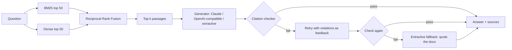

# Grounded DocQA

**Retrieval-augmented question answering over technical documentation, where every sentence of an answer is checked against the passage it cites.**

Ask a question about the FastAPI docs and get a short answer with numbered citations. Before an answer is shown, a checker verifies that each sentence cites a retrieved passage and that every number and `code identifier` in it actually appears in that passage. If an LLM's answer fails the check, it is retried once with the errors as feedback, and if it still fails the system falls back to quoting the docs rather than showing an unsupported claim.


## Results

Measured on 40 hand-labeled questions over the FastAPI tutorial (51 pages, 553 chunks), plus 10 off-topic questions. Reproduce with the commands under [Evaluate](#evaluate); CI re-runs this on every push.

| Retrieval | Recall@1 | Recall@3 | Recall@5 | MRR |
|---|---|---|---|---|
| BM25 (from scratch) | 0.925 | 0.950 | 0.950 | 0.944 |
| Dense (LSA vectors) | 0.925 | 1.000 | 1.000 | 0.963 |
| **Hybrid (Reciprocal Rank Fusion)** | **0.975** | **1.000** | **1.000** | **0.988** |

| Answers (offline extractive mode) | Rate |
|---|---|
| Answers that pass the citation checker | 1.000 |
| In-scope questions answered from a correct document | 0.850 |
| In-scope questions wrongly refused | 0.075 |
| Off-topic questions correctly refused | 1.000 |

Warm latency on a laptop CPU: about 5 ms per hybrid search; 7.7 ms p50 / 10.9 ms p95 per `/ask` request end to end in extractive mode (from the service's own `/metrics` endpoint).

## How it works



1. **Chunking** (`docqa/chunking.py`): splits Markdown on headings so a chunk never mixes sections, then packs whole paragraphs into chunks of at most 180 words. Code blocks are never cut in half, and each chunk carries its heading path (`Handling Errors > Raise an HTTPException`).
2. **BM25** (`docqa/bm25.py`): Okapi BM25 with an inverted index, written from scratch (k1 = 1.5, b = 0.75).
3. **Dense retrieval** (`docqa/dense.py`): LSA (TF-IDF + truncated SVD, 256 dimensions) by default so it runs anywhere with no model download; any sentence-transformers model can be swapped in with `--embedder st:<model>`.
4. **Hybrid fusion** (`docqa/index.py`): Reciprocal Rank Fusion, `score = Σ 1 / (60 + rank)`. It uses ranks only, so BM25's unbounded scores and cosine similarities never need calibrating against each other.
5. **Grounding check** (`docqa/grounding.py`): rejects uncited sentences, citations to passages that were not retrieved, and numbers or identifiers that do not appear in the cited passage.
6. **API** (`docqa/api.py`): FastAPI with request validation, access logging and a `/metrics` endpoint (p50/p95 latency, grounded rate, fallback rate). The built React UI is served from the same container.
7. **Web UI** (`frontend/`): React + TypeScript. Citations render as buttons that open the exact passage they point to.

## Run it

**Docker** (builds the UI, downloads the corpus and builds the index):
```bash
docker build -t grounded-docqa .
docker run -p 8000:8000 grounded-docqa          # open http://localhost:8000
```

**Local development**:
```bash
./scripts/fetch_corpus.sh                       # FastAPI tutorial docs, pinned commit
cd backend
python -m venv .venv && source .venv/bin/activate
pip install -e ".[dev]"
docqa ingest data/corpus --out data/index.pkl
DOCQA_SERVE=1 uvicorn docqa.api:app --reload    # API on :8000

cd ../frontend && npm install && npm run dev    # UI on :5173, proxies /api to :8000
```

**Use an LLM** instead of the offline extractive answers:
```bash
export DOCQA_LLM=anthropic ANTHROPIC_API_KEY=...            # Claude
export DOCQA_LLM=openai OPENAI_BASE_URL=http://localhost:11434/v1 DOCQA_MODEL=llama3.1   # local Ollama
```

**Command line**:
```bash
docqa ask "How do I return a 404 error when an item is not found?"
```

## Evaluate

```bash
cd backend
python -m docqa.cli eval eval/questions.jsonl --out-of-scope eval/out_of_scope.jsonl --json eval/results.json
```

`eval/questions.jsonl` holds 40 questions written in plain language (not copied from headings), each labeled with the document(s) that answer it. `eval/out_of_scope.jsonl` holds 10 questions the docs cannot answer.

## API

| Method | Path | Body / response |
|---|---|---|
| `POST` | `/ask` (also `/api/ask`) | `{"question": str, "k": 1-10, "mode": "hybrid"\|"bm25"\|"dense"}` → answer, sources, grounded, generator, timings |
| `GET` | `/health` | status, number of chunks, active generator |
| `GET` | `/metrics` | request count, p50/p95 latency, grounded rate, fallback rate |

## Tests

```bash
cd backend && pytest -q        # 42 tests: chunking, BM25, retrieval modes, grounding, retry/fallback, API
cd frontend && npm test        # citation parsing
```

The retry and fallback logic is tested with scripted fake LLMs, so the whole suite runs offline in about a second.

## Design decisions

- **Ranks, not scores, for fusion.** Normalizing BM25 and cosine scores onto one scale is fragile; RRF needs no tuning and improved Recall@1 from 0.925 to 0.975 here.
- **No stemming in BM25.** A plural-stripping stemmer *lowered* BM25 Recall@1 from 0.925 to 0.850 on this eval (it merges terms like `status`/`statuses` that matter in API docs), so it is used only when matching answer sentences.
- **Fail closed.** An answer the checker cannot verify is replaced by quoted documentation rather than shown with a warning.
- **LSA by default.** It keeps the project runnable on any laptop or CI runner with no GPU or model download; the embedder is a one-flag swap.

## Limitations and next steps

- The checker verifies numbers and identifiers, not the meaning of a sentence; an LLM could still paraphrase a passage wrongly. An entailment model (NLI) per sentence is the natural next step.
- The eval set is small (40 + 10 questions) and labels documents, not passages.
- The extractive fallback quotes lead sentences of the best passage, so it can be correct but incomplete.

## License

MIT. The demo corpus is the FastAPI documentation (MIT, © Sebastián Ramírez), downloaded at build time and not redistributed here.
